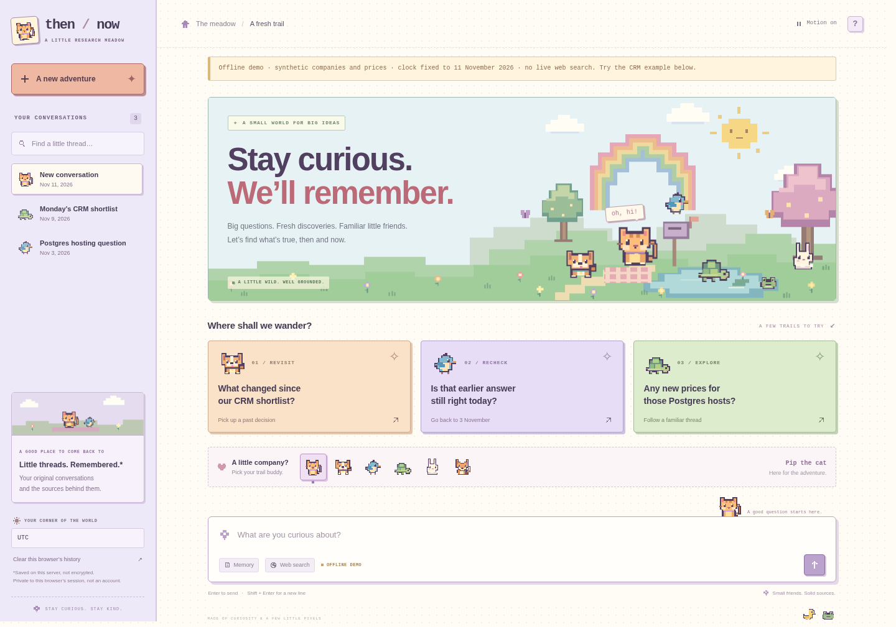

# Then / Now · Research Meadow

**A web-search chat agent that remembers the original conversation before checking what changed.**

Built for the minimi hiring challenge. TypeScript on Node, SQLite, OpenAI Responses, and Tavily Search. One external tool: **web search**. Zero runtime npm dependencies. No agent framework, Redis, vector database, browser automation, or container infrastructure required.

Start with **[DESIGN.md](DESIGN.md)** for the one-page architecture. See **[docs/ARCHITECTURE.md](docs/ARCHITECTURE.md)** for the invariants and tradeoffs, and **[evals/RUBRIC.md](evals/RUBRIC.md)** for evaluation criteria.

## The Research Meadow edition

An animated pixel-art world around the same provenance-first agent. Cats, dogs, birds, turtles, rabbits, foxes, frogs, and ducks live in an original, locally rendered SVG meadow. The interface uses peach, lavender, mint, and butter-yellow surfaces, stepped illustrations, pixel icons, and tactile card shadows.



Choose **Pip the cat, Scout the dog, Wren the bird, Moss the turtle, Clover the rabbit, or Fern the fox** as a visual companion. The selected animal appears beside the composer, in assistant avatars, and during actual agent activity. Companion selection never changes the agent's answers or capabilities.

Clouds drift, animals blink and hop, butterflies wander, and the pond glimmers. The **Motion** control pauses all decorative animation; system reduced-motion preferences take precedence. There is no audio, canvas render loop, animation library, remote artwork, or bundled font.

The responsive conversation drawer, local conversation filter, source and memory dialogs, streaming status, Stop control, timezone settings, and history deletion all work. The welcome composer remains in normal flow on narrow screens so it cannot cover the prompt cards; the conversation composer stays sticky.

See **[the UI architecture and upgrade notes](docs/UI.md)**, **[mobile preview](docs/preview-mobile.png)**, **[animated scene preview](docs/preview-meadow.gif)**, and **[the validation record](docs/VALIDATION.md)**. No new API keys or database migrations are required.

## Run

Use Node 24, or Node 22.16+; `.nvmrc` selects the Node 24 line. This repository uses Node’s built-in SQLite and type stripping, so Node 20 will not work. Experimental warnings on Node 22 are expected.

```bash
npm install
cp .env.example .env
# Set OPENAI_API_KEY and TAVILY_API_KEY in .env.
npm run dev
```

Open `http://localhost:3000`. All keys stay on the server. The UI boots without keys and explains what is missing; it does not silently substitute mocked answers.

The only API keys are `OPENAI_API_KEY` and `TAVILY_API_KEY`. All configuration, including model snapshots, is listed in `.env.example`. Defaults use GPT-5.4 mini for planning/checking and GPT-5.4 for synthesis; these are configurable choices, not a claim to use the newest models. API account access and billing are required for live answers.

### Explore without keys

```bash
npm run demo
```

This is an **explicit offline fixture** with fictitious CRM companies/prices, a fixed clock of 11 November 2026, and seeded historical discussions. The banner and responses identify it as synthetic. It exercises the actual orchestration, storage, validation, UI and HTTP endpoints, but uses deterministic providers. It is not a substitute for evaluating the real agent.

Demo and live modes use different database files by default. Avoid overriding both to the same `DATABASE_PATH`. Stop the other server before starting a different mode on the same port.

## What is different

A question such as “On Monday we shortlisted five CRMs; did any pricing change or anything big ship?” is decomposed into the **original five entities**, the **exact historical constraints**, and **ten requested checks**. Current prices are not treated as evidence of an intervening change. A historical assistant answer is evidence of what the assistant said, not proof that the old claim was ever true.

The answer distinguishes:

| Verdict | Meaning |
| --- | --- |
| Change verified | Evidence establishes a real, comparable change after the baseline. |
| Supported now | Current evidence supports the earlier statement; not proof of uninterrupted stability. |
| Prior answer needs revision | Current evidence differs, but a real-world change since the discussion is not established. |
| No change found | A bounded search did not locate a relevant change. Absence is not proven. |
| Not verified | Evidence, historical baseline, or comparable scope is missing. |
| Sources disagree | Material conflicting evidence remains unresolved. |

Click a citation to see the exact supporting quote and source timestamps. Click a date to see the original message. Saved historical source citations remain inspectable. “How this answer was checked” exposes execution phases and usage, not private model reasoning.

## Test and evaluate

```bash
npm run typecheck
npm test
npm run eval
npm run test:coverage

# Explicitly opt in to paid real-provider smoke evaluations:
RUN_LIVE_EVALS=1 npm run eval:live
```

The 108-test suite covers local art and presentation contracts, static-asset security, calendar/zone handling, historical retrieval, user isolation, request idempotency, strict schemas, scope and quotation checks, HTTP/SSE behavior, cancellation signals, bounded retries, and fixture end-to-end turns. The offline evaluation has eight regression cases. **Neither is a live model accuracy score.** The opt-in live harness records actual outputs, latency, request counts and usage for independent review; it does not self-grade truthfulness.

See **[docs/VALIDATION.md](docs/VALIDATION.md)** for what was actually exercised in the build environment and what was not.

## Small code map

```text
src/
  server.ts                  HTTP, identity, same-origin checks, SSE, lifecycle
  contracts.ts               Shared types + strict model-output contracts
  config.ts                  Validated environment configuration
  presentation.ts            Compact replay payloads; full snapshots stay in SQLite
  agent/
    agent.ts                 Bounded orchestration, routing and repair policy
    prompts.ts               Planning, synthesis and entailment contracts
    grounding.ts             Deterministic provenance/scope/coverage gates
    budget.ts                Request limits, cancellation and bounded parallelism
  memory/
    time.ts                  Timezone-aware civil-day resolution
    store.ts                 SQLite, FTS5, immutable originals and scoped retrieval
  providers/
    openai.ts                Responses API structured-output adapter
    search.ts                The only external tool: Tavily /search
    http.ts                  Transient retry policy and response-size limits
  demo.ts                    Explicit synthetic provider fixtures
public/
  index.html                 Semantic app shell and colorful meadow layout
  app.js                     Chat, SSE, history, evidence, and error handling
  meadow.js                  Companions, motion preferences, help, mobile drawer
  pixel-art.js               Original integer-grid SVG animals, scenery, icons
  style.css                  Pixel visual system, responsive layout, motion
  favicon.svg                Local pixel-cat favicon
  *.d.ts                     Explicit browser-module export contracts
tests/                      Unit + contract + HTTP + fixture integration tests
evals/                      Offline regressions and opt-in live evaluation
```

## Storage, identity, and deployment

Live data lives in `data/agent.sqlite`. Original conversations survive restarts and are retrievable across threads within the same browser identity. The anonymous session cookie is an opaque bearer credential; it is not an account. A different browser or a cleared cookie has a different history. The UI loads the latest 100 messages in a thread; the retrieval index retains older messages.

“Clear this browser’s history” deletes that identity’s conversations, stored evidence and run results. This is logical SQLite deletion, not guaranteed forensic erasure of disk pages or external backups. Data is plaintext on disk with restrictive permissions, not encrypted-at-rest. Keys are never stored in the browser or conversation database.

The default bind is loopback. For remote review, set `HOST=0.0.0.0`, a strong `APP_PASSWORD`, and the exact HTTPS `PUBLIC_ORIGIN`. The browser uses HTTP Basic access control; any username is accepted and the configured password is required. Put a TLS reverse proxy in front. Do not expose the unprotected local server or rely on anonymous cookies as production authentication. This is a single-process application; run only one instance against a database. The startup recovery pass assumes one process owns active runs.

The request budget is five physical model requests, twelve physical search requests and a 90-second default turn limit. Transient retries consume that budget. Search concurrency is four; at most eight turns execute at once. Per-session rate limiting is a local abuse guard, not a distributed/public anti-abuse service. The app has no cross-user search cache and no cross-turn freshness cache; deduplication is turn-local.

## HTTP contract

`GET /api/session` creates/resumes a browser identity and lists conversations. `POST /api/threads` creates a thread. `GET /api/messages?thread_id=...` reads owned history. `GET /api/sources/:id` reads an owned saved snapshot. `DELETE /api/memory` forgets that identity’s data.

`POST /api/chat` accepts JSON:

```json
{
  "thread_id": "t_...",
  "request_id": "client-generated-unique-id",
  "text": "Has any pricing changed since our shortlist?",
  "timezone": "Asia/Kolkata"
}
```

The server derives user identity from its cookie; it never trusts a client-supplied user ID or clock. SSE events are `started`, `status`, `source`, `answer`, `done`, or `error`. Progress streams while work runs; **final answer text is not token-streamed before verification**. Replay a completed request with the same ID and identical thread/text/timezone to recover the saved result without re-executing. A failed request requires a new ID; an in-progress duplicate returns 409. Disconnecting or clicking Stop cancels provider work and does not save an unfinished assistant answer.

## Deliberate limitations

Lexical/date retrieval can miss an old paraphrase with no shared terms. Date parsing covers common English weekdays, relative days, month-name dates, ISO dates and “last week,” not every language or arbitrary date expression. Rare midnight timezone transitions fail explicitly. Source snapshots are what the search provider returned, possibly cached or excerpted; they are not forensic site archives. Exact-quote checks do not prove entailment, and the model verifier can be wrong or share the generator’s biases. Conservative price-scope matching can abstain even when a human could reconcile aliases. Prompt-injection defenses reduce risk but are not a demonstrated complete defense. There are no advertised live latency or accuracy numbers.

## Publish the submission

The archive is repository-ready but does not create a public GitHub repository or submit an application. After reviewing the code and running the live evaluation:

```bash
git init
git add .
git commit -m "Build provenance-first temporal chat agent"
# With an authenticated GitHub CLI:
gh repo create then-now-agent --public --source=. --remote=origin --push
```

Do not commit `.env`, databases or private evaluation results. Include `DESIGN.md` in the repository and submit the resulting public repository URL through the challenge’s application form.
